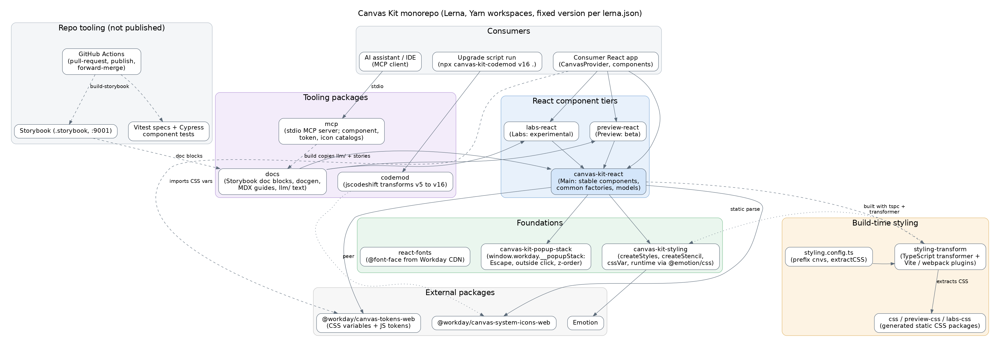

# Canvas Kit Architecture

This document describes how the code on `master` is organized today: which packages the monorepo
publishes, how they depend on each other, how styles get from TypeScript into CSS, and how the repo
is built, tested and released. For contribution rules (branching, config, styling, testing), see
[AGENTS.md](./AGENTS.md), [STYLE.md](./STYLE.md) and
[MAINTAINING.mdx](modules/docs/mdx/MAINTAINING.mdx).



The diagram is generated from [architecture/architecture.dot](architecture/architecture.dot)
(Graphviz). After editing it, run `./architecture/render.sh` to regenerate
[architecture.png](architecture/architecture.png) and
[architecture.svg](architecture/architecture.svg), and commit all three files together.

## Monorepo layout

Canvas Kit is a Yarn (classic) workspaces monorepo. Every directory under `modules/` is an npm
package, and [Lerna](./lerna.json) runs `build`, `clean`, `depcheck` and `watch` across them. All
packages are released together at a single fixed version (`version` in `lerna.json`, currently
`16.1.1`).

| Directory                                                | Package                                                | What it does                                                                                                                                                                                                                 |
| -------------------------------------------------------- | ------------------------------------------------------ | ---------------------------------------------------------------------------------------------------------------------------------------------------------------------------------------------------------------------------- |
| `modules/react`                                          | `@workday/canvas-kit-react`                            | Main tier: stable components (button, menu, modal, select, table, tabs, ...), plus `common` (component factories, `CanvasProvider`, theming), `collection` (list/grid models), `popup` (popup model and hooks) and `layout`. |
| `modules/preview-react`                                  | `@workday/canvas-kit-preview-react`                    | Preview tier: approved components whose API may still change. Depends on `canvas-kit-react`.                                                                                                                                 |
| `modules/labs-react`                                     | `@workday/canvas-kit-labs-react`                       | Labs tier: experimental components that are not fully reviewed. Depends on `canvas-kit-react`.                                                                                                                               |
| `modules/styling`                                        | `@workday/canvas-kit-styling`                          | Styling API used by all components: `createStyles`, `createStencil`, `createVars`, `cssVar`, `handleCsProp` (the `cs` prop), and the shared Emotion cache (`getCache`). At runtime it inserts styles through `@emotion/css`. |
| `modules/styling-transform`                              | `@workday/canvas-kit-styling-transform`                | Build-time TypeScript transformer that rewrites `createStyles`/`createStencil` calls into static CSS, with Vite and webpack plugins. Not used by consumers at runtime.                                                       |
| `modules/css`, `modules/preview-css`, `modules/labs-css` | `@workday/canvas-kit-css`, `-preview-css`, `-labs-css` | Static CSS files extracted by `styling-transform` from the matching React package, one file per component directory.                                                                                                         |
| `modules/popup-stack`                                    | `@workday/canvas-kit-popup-stack`                      | Framework-agnostic FILO stack of open popups, shared on `window.workday.__popupStack`, so popups from different Canvas Kit versions or frameworks agree on z-order, Escape and outside-click handling.                       |
| `modules/react-fonts`                                    | `@workday/canvas-kit-react-fonts`                      | Optional `@font-face` declarations that load the official fonts from the Workday CDN.                                                                                                                                        |
| `modules/codemod`                                        | `@workday/canvas-kit-codemod`                          | `canvas-kit-codemod` CLI: `jscodeshift` transforms for upgrades (`v5` to `v16`, plus `v13.2` and `v14-tokens`).                                                                                                              |
| `modules/mcp`                                            | `@workday/canvas-kit-mcp`                              | `canvas-kit-mcp` stdio MCP server for AI assistants: component, token and icon search and validation tools, upgrade guides, and docs resources, backed by committed JSON catalogs.                                           |
| `modules/docs`                                           | `@workday/canvas-kit-docs`                             | Storybook documentation: MDX guides and upgrade guides, doc blocks (`ExampleCodeBlock`, `SymbolDoc`), the TypeScript docgen used to build props tables, and the plain-text `llm/` docs the MCP server ships.                 |

Outside `modules/`:

- `.storybook/` configures Storybook (React + Vite) on port 9001. It loads stories and MDX from
  every module and applies `styling-transform` through `.storybook/typescript-transform.ts`.
- `cypress/` holds Cypress component tests that mount Storybook examples.
- `test-utils/` holds shared Vitest helpers such as `verifyComponent`.
- `utils/` holds repo scripts: component scaffolding (`yarn create-component`), component promotion,
  font download, lockfile and dependency checks, and publishing.
- `styling.config.ts` is the shared `styling-transform` configuration (class prefix `cnvs`,
  `cnvs-preview`/`cnvs-labs` for those tiers, CSS extraction into `modules/*-css`).

## Package dependencies

```
labs-react ────┐
               ├─> react ─┬─> styling ─> @emotion/css
preview-react ─┘          ├─> popup-stack
                          ├─> @workday/canvas-tokens-web
                          └─> @workday/canvas-system-icons-web
```

- Consumers install `canvas-kit-react` (and optionally the preview and labs packages) together with
  `@workday/canvas-tokens-web`, whose CSS variable files they import once at the app root.
- `canvas-kit-react`, `preview-react` and `labs-react` declare `react >=17.0` as a peer dependency
  and depend on Emotion `^11.7.1` directly.
- `codemod`, `mcp` and `styling-transform` are standalone tools; none of the React packages depend
  on them at runtime.

## Component model

Components are built with the factories in `modules/react/common/lib/utils`:

- `createComponent` for a styled element with no shared state.
- `createContainer` and `createSubcomponent` for compound components: the container creates or
  receives a model and provides it through React context; subcomponents read it.
- `createModelHook` for models (state plus events, with `should<Event>` guards and `on<Event>`
  callbacks).
- `createElemPropsHook` and `composeHooks` for reusable prop/behavior hooks applied to elements.

Shared models live in `common`, `collection` (list, cursor, selection, grid and overflow models used
by menus, selects, tabs, action bars and tables) and `popup` (`usePopupModel`). The popup hooks
(`useCloseOnEscape`, `useCloseOnOutsideClick`, `useBringToTopOnClick`, `useReturnFocus`, ...)
register each open popup with `popup-stack`, which decides which popup is on top.

`CanvasProvider` sets up the Emotion cache from `canvas-kit-styling`, the text direction, and
optional theme variables (for example `sanaCanvasProviderTheme` when the app cannot set `data-theme`
on `<html>`).

## Styling pipeline

Components style themselves with `createStyles` and `createStencil` from `canvas-kit-styling`,
referencing CSS variables from `@workday/canvas-tokens-web`. The same source works in two modes:

1. **Runtime.** Without a build step, `createStyles` serializes style objects and inserts them
   through `@emotion/css` into the shared cache.
2. **Build-time.** Package builds (`tspc` with `.storybook/typescript-transform.ts`) and Storybook
   run `styling-transform`. It evaluates the style objects statically, replaces each call with
   precomputed class names and CSS strings, and, because `extractCSS` is on in `styling.config.ts`,
   writes the CSS for `modules/<tier>-react/<component>` to `modules/<tier>-css/<component>.css`.

Each React package is compiled twice, to CommonJS (`dist/commonjs`) and ES modules (`dist/es6`).

## Build, test and release

| Command                                | What it runs                                                              |
| -------------------------------------- | ------------------------------------------------------------------------- |
| `yarn start`                           | Downloads fonts, then Storybook dev server on port 9001                   |
| `yarn build`                           | `lerna run build` (each package's `build`, after `yarn depcheck`)         |
| `yarn lint`                            | Lockfile and mismatched-dependency checks, then ESLint                    |
| `yarn typecheck`                       | `typecheck:src` (per package), `:cypress`, `:types`, `:specs`, `:stories` |
| `yarn test`                            | Vitest (jsdom) for every `spec/*.spec.ts(x)`                              |
| `yarn cypress:run`                     | Cypress component tests                                                   |
| `yarn build-storybook`                 | Static Storybook into `docs/`                                             |
| `yarn test:catalog` (in `modules/mcp`) | MCP catalog checks                                                        |

GitHub Actions workflows in `.github/workflows/`:

- `pull-request.yml` runs lint, depcheck, typecheck, unit tests, the Storybook build and Cypress on
  every PR.
- `publish.yml` routes releases: patch releases publish automatically on pushes to `master` and
  `support`, canary releases on `prerelease/*` branches, and minor and major releases are started
  manually (`release-minor.yml`, `release-major.yml`).
- `forward-merge.yml` merges `support` into `master` into `prerelease/minor` into `prerelease/major`
  after each change.
